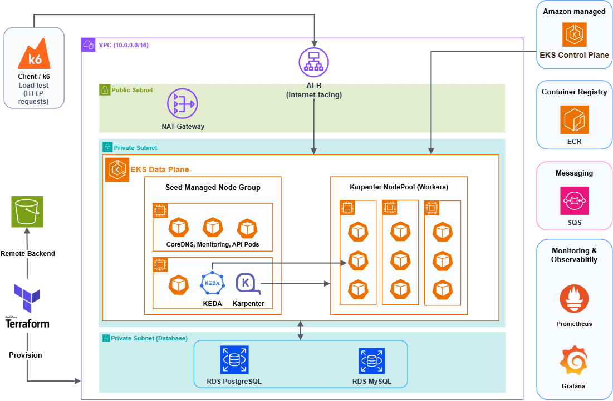
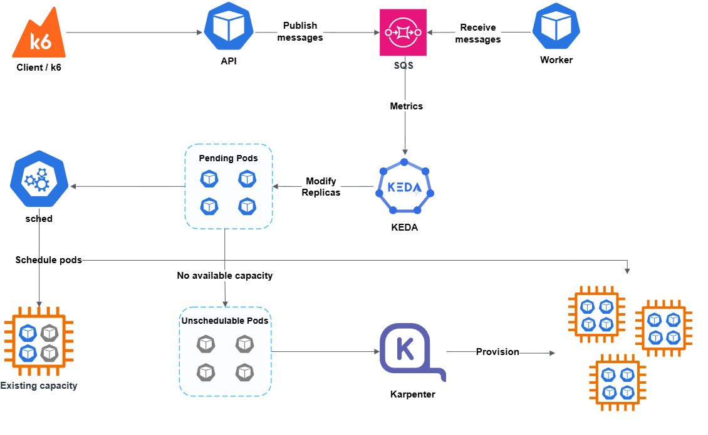

# Two-Level Autoscaling for Event-Driven Microservices

This repository is the infrastructure and orchestration hub for the **Two-Level Autoscaling for Event-Driven Microservices on Amazon EKS** project. It contains Terraform for AWS infrastructure and optional monitoring, plus Kubernetes manifests for application deployment.

## Project Overview

Traditional CPU-based autoscaling often falls short for asynchronous, queue-based workloads. This coursework project demonstrates scaling worker pods from queue backlog and provisioning EC2 nodes when needed.

The architecture implements a two-level elasticity model:
- **Pod-Level Elasticity (KEDA):** Dynamically scales worker pods from `0 → N → 0` based on Amazon SQS queue depth via external metric triggers.
- **Node-Level Elasticity (Karpenter):** Automatically provisions and consolidates On-Demand EC2 capacity when pods are pending due to insufficient cluster capacity. Spot is an optional later experiment.

This repository provisions the underlying AWS platform and coordinates the deployment, scaling policies, and benchmarking experiments across the entire ecosystem.

## System Architecture & Workflow

**Core Data Flow:** 
`Traffic (k6)` → `Producer API` → `Amazon SQS` → `Worker Pods (Scaled by KEDA)` → `EC2 Nodes (Provisioned by Karpenter)`

## Technology Stack

* **Cloud Provider:** Amazon Web Services (EKS, EC2, SQS, ECR, IAM, VPC)
* **Infrastructure as Code (IaC):** Terraform
* **Orchestration & Scaling:** Kubernetes, KEDA, HPA, Karpenter
* **Messaging:** Amazon SQS (Decoupling Producers and Workers)
* **Observability:** Prometheus, Grafana
* **Load Testing:** k6

---

## KEDA deployment

See [Terraform deployment](terraform/README.md) for the staged apply sequence, RDS configuration, EKS API CIDR, budget and optional monitoring.

Terraform pins EKS `1.36`, Karpenter `1.15.0`, and KEDA `2.21.0`. The KEDA module installs the official Helm chart in the `keda` namespace and creates a `ClusterTriggerAuthentication` named `keda-sqs-pod-identity`. Its operator ServiceAccount is `keda-operator`, matching the EKS Pod Identity association and read-only SQS policy in the IAM module. No AWS access keys are stored in Kubernetes.

## SQS workload identities

The IAM module creates one EKS Pod Identity role and association per API producer and per worker. Each API can send to its own main queue; each worker can consume only its own main queue. Worker roles have no DLQ permissions. KEDA has a separate read-only role for queue depth.

| Main queue | API ServiceAccount | Worker ServiceAccount |
|---|---|---|
| `cart-queue` | `cart-api` | `cart-worker` |
| `checkout-queue` | `checkout-api` | `checkout-worker` |
| `orders-queue` | `orders-api` | `orders-worker` |

<!-- ---

## Related Repositories

This infrastructure hosts and orchestrates the following application components:

### 1. [retailstore-backend-microservices](https://github.com/UITMagnolia/retailstore-backend-microservices)
**Role:** Backend Microservices & Asynchronous Processing  
**Description:** Houses the core backend services, including the Producer APIs and background Workers. Implements the business logic, event-driven task processing with Amazon SQS, and container configurations for deployment on Kubernetes.

### 2. [retailstore-android](https://github.com/UITMagnolia/retailstore-android)
**Role:** Mobile Client Application  
**Description:** Native Android client providing the retail store user interface. Interacts with the backend microservices to generate user traffic, handle transactions, and demonstrate real-world workload generation. -->
