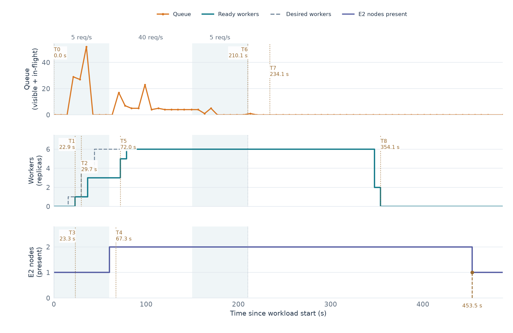

# E2 — Cold start Pod và co giãn hai tầng KEDA + Karpenter

**Câu hỏi:** Khi tải đến lúc chưa có worker nhưng đã có một node worker, Pod khởi động mất bao lâu, KEDA và Karpenter mở rộng như thế nào khi cần thêm capacity, và worker trở về 0 sau tải ra sao?

**Điều kiện đầu:** 0 worker Pod, 1 node `e2-orders` Ready được bảo vệ khỏi consolidation; hai node hệ thống chạy API, KEDA, Karpenter và monitoring. Queue và DLQ đã drain. Node sẵn làm cho cold start đầu tiên là cold start Pod trên node có sẵn; các node worker mới chỉ được tạo nếu capacity không đủ. Ghi node, capacity còn lại và timestamp thực tế trước mỗi lượt.

```text
Tải đến → cold start Pod trên node sẵn → scale-out Pod
→ nếu thiếu capacity: Pod chờ → tạo node mới → Pod Ready
→ dừng tải → queue drain → cooldown → 0 worker Pod
```

Node ban đầu có annotation `karpenter.sh/do-not-disrupt=true` nên không bị consolidation tự nguyện thu hồi; các node E2 khác vẫn có thể được thu hồi. Annotation không ngăn mọi nguyên nhân mất node. Không mặc định sẽ có Pod thiếu capacity hoặc node mới: nếu không quan sát thấy, ghi `N/A` cho các mốc tương ứng.

## Thiết kế đo và timeline

Thu ít nhất 75 giây baseline không phát tải. T0 là lúc bắt đầu phát workload của lượt đo; gauge bắt đầu hiện tại được ghi trong k6 `setup`, nên có thể lệch so với request đầu tiên. Ghi timestamp UTC, nguồn và độ phân giải cho từng mốc; khi đo provisioning, đối chiếu Pod UID, scheduler event, NodeClaim, provider ID và node tương ứng.

| Mốc | Định nghĩa |
|---|---|
| T0 | Bắt đầu phát tải. |
| T1 | Worker đầu tiên Ready trên node E2 sẵn có. |
| T2 | Quan sát Pod `Unschedulable` do thiếu capacity. |
| T3 | NodeClaim mới được tạo; đây là proxy, không phải thời điểm chính xác Karpenter bắt đầu xử lý. |
| T4 | Node mới gắn với NodeClaim Ready. |
| T5 | Pod từng chờ ở T2 Ready trên node T4, xác nhận bằng cùng Pod UID. |
| T6 | Dừng phát tải. |
| T7 | Queue drain được xác nhận qua nhiều mẫu visible/in-flight/delayed và DLQ. |
| T8 | Deployment được quan sát về 0 worker Pod sau tải. |

| Khoảng đo | Công thức |
|---|---|
| Cold start Pod trên node sẵn | `T1 − T0` |
| Provisioning node | `T4 − T3` |
| Pod khởi động trên node mới | `T5 − T4` |
| Queue drain sau tải | `T7 − T6` |
| Scale về 0 Pod sau tải | `T8 − T6` |

Thu thêm peak backlog, throughput, p95/p99 E2E, số worker và node theo thời gian; ghi rõ nguồn và cửa sổ. `T8 − T6` không phải riêng thời gian cooldown: cooldown tính từ lần cuối trigger được ghi nhận hoạt động. NodeClaim là proxy; `T4 − T3` không chứng minh toàn bộ khoảng đó gây tăng latency end-to-end.

Các mốc lấy mẫu có thể không phản ánh chính xác thứ tự thực tế. Không tính khoảng âm hoặc điền 0 khi thiếu bằng chứng; ghi `N/A`. Không quy kết Pod Pending do thiếu CPU nếu scheduler event cho thấy IAM, quota, taint hoặc nguyên nhân khác. SQS và histogram là số ước lượng.

`timeline.py` xuất các mốc T0–T8 và khoảng thời gian có thể suy ra từ mẫu; `null` nghĩa là chưa đủ bằng chứng. Mốc T2–T5 liên kết Pod và node là ứng viên, cần đối chiếu scheduler event và nguyên nhân thiếu capacity. `report.py` tính các metric tổng hợp; đối chiếu raw và bổ sung nguồn khi cần.



## Kết quả thực nghiệm E2


Hai lượt `r01` và `r02` được trình bày riêng và có thêm trung bình cộng để tham khảo.

Hai lượt [r01](../results/E2/E2-elastic-burst-r01/report.json) và [r02](../results/E2/E2-elastic-burst-r02/report.json) dùng Burst v5: 5 request/s trong 60 giây → 40 request/s trong 90 giây → 5 request/s trong 60 giây. Mỗi lượt bắt đầu với 0 worker, một node E2 Ready được bảo vệ và queue/DLQ rỗng theo mẫu. Report ghi cùng cấu hình worker và image digest; KEDA đặt min 0, max 10, polling 5 giây và cooldown 150 giây.

### Phản ứng khi tăng tải

- **Cold start:** worker đầu tiên trên node có sẵn được quan sát Ready sau 24,6 giây ở r01 và 22,9 giây ở r02, tính từ đầu pha 5 request/s. Đây là thời gian quan sát được, không phải cold start tính từ spike 40 request/s.
- **Scale-out:** cả hai lượt tạo NodeClaim đầu tiên trong pha 5 request/s, trước spike. Ở r01, thêm một NodeClaim được tạo khoảng 16,1 giây sau spike; Pod từng chờ do thiếu CPU được quan sát Ready trên node tương ứng khoảng 56,4 giây sau spike. Ở r02, NodeClaim bổ sung duy nhất được tạo khoảng 36,7 giây trước spike và không quan sát thêm NodeClaim trong pha cao. Vì vậy không quy tất cả node mới cho spike 40 request/s.
- **Queue và latency:** trong hai lượt, r02 có peak queue và p95 E2E quan sát thấp hơn r01. r02 đạt 6 worker Ready khoảng 18,8 giây sau spike; r01 đạt 6 worker Ready khoảng 28,7 giây sau spike. Khác biệt thời điểm capacity có thể góp phần, nhưng dữ liệu không xác định được nguyên nhân duy nhất hoặc cho phép khẳng định throughput đã ổn định ở 40 request/s.
- **Kết thúc tải:** hai lượt đều ghi queue và DLQ bằng 0 ở snapshot cuối, worker về 0 và node E2 ban đầu vẫn được bảo vệ. Khoảng từ khi dừng tải đến khi quan sát 0 worker không phải phép đo riêng cooldown 150 giây: cooldown được tính từ lần cuối trigger hoạt động, không nhất thiết từ lúc k6 dừng.

Cả hai lượt ghi 4.199 request được API chấp nhận, không HTTP failure và không ghi nhận dropped iterations. Report tính success bằng delta từng chuỗi Pod nên bỏ giá trị đã có ở mẫu đầu; cộng phần đó vào cho tổng mẫu cuối 4.199 ở mỗi lượt. Chưa đối chiếu job ID nên không kết luận mỗi job được xử lý đúng một lần. Xem thêm [log controller](controller-log-e2-r01-r02.jsonl), [report r01](../results/E2/E2-elastic-burst-r01/report.json) và [report r02](../results/E2/E2-elastic-burst-r02/report.json).


### Các mốc quan sát

Các số trong bảng là **số giây từ T0 của từng lượt**. T0 tương ứng `2026-11-07 20:10:37,905 UTC` ở r01 và `2026-11-08 08:04:35,729 UTC` ở r02; T0 và T6 lấy từ k6 setup/teardown. T2, T4 và T5 là lần đầu collector quan sát trạng thái; T3 lấy thời điểm tạo NodeClaim. Phần thập phân giúp đối chiếu timestamp, không phản ánh độ chính xác phép đo: khoảng giữa các mẫu worker có trung vị khoảng 7 giây.

| Mốc | Ý nghĩa | r01: giây từ T0 | r02: giây từ T0 |
|---|---|---:|---:|
| T0 | Bắt đầu workload | 0,00 | 0,00 |
| T1 | Worker đầu tiên Ready trên node sẵn | 24,60 | 22,91 |
| T2 | Quan sát Pod chờ do thiếu CPU | 18,02 | 29,66 |
| T3 | NodeClaim đầu tiên được tạo | 16,10 | 23,27 |
| T4 | Quan sát node tương ứng Ready | 55,30 | 67,26 |
| T5 | Quan sát Pod từng chờ Ready trên node mới | 59,73 | 72,05 |
| T6 | Kết thúc workload | 210,06 | 210,06 |
| T7 | Xác nhận queue drain | 230,85 | 234,08 |
| T8 | Quan sát worker về 0 Pod | 354,85 | 354,12 |

T2 có thể xuất hiện sau T3 trong bảng vì T2 là **lần đầu quan sát** Pod chờ, còn T3 là timestamp tạo NodeClaim; điều này không chứng minh NodeClaim được tạo trước khi Pod thực sự chờ. T1 cũng không nhất thiết xảy ra trước T2 vì nhiều Pod có thể được yêu cầu gần nhau. Các mốc T2–T5 ở đây liên kết với NodeClaim **đầu tiên**, được tạo trong pha 5 request/s.

### Các khoảng đo từ timeline

| Khoảng đo | Công thức | r01 (giây) | r02 (giây) |
|---|---|---:|---:|
| Cold start worker trên node sẵn | T1 − T0 | 24,6 | 22,9 |
| Tạo NodeClaim → quan sát node Ready | T4 − T3 | 39,2 | 44,0 |
| Quan sát node Ready → Pod từng chờ Ready | T5 − T4 | 4,4 | 4,8 |
| Dừng workload → xác nhận queue drain | T7 − T6 | 20,8 | 24,0 |
| Dừng workload → quan sát 0 worker | T8 − T6 | 144,8 | 144,1 |

Các khoảng được làm tròn theo `timeline.json` của từng lượt: [r01](../results/E2/E2-elastic-burst-r01/timeline.json), [r02](../results/E2/E2-elastic-burst-r02/timeline.json). T4 − T3 là khoảng từ lúc tạo NodeClaim đến lúc **quan sát** node Ready, không phải phép đo chính xác toàn bộ thời gian provisioning.

### Bảng kết quả và trung bình

Cột trung bình là trung bình cộng của **hai lượt**, không phải giá trị đại diện đã xác lập cho hệ thống. Trung bình p95/p99 là trung bình các percentile theo từng lượt, không phải percentile tính lại từ dữ liệu gộp. SQS là giá trị xấp xỉ; peak, số Pod/node và các mốc Ready là giá trị quan sát theo mẫu. Histogram E2E có thể gồm error/duplicate và chịu ảnh hưởng thời điểm scrape. Node-minutes đếm thời gian node E2 hiện diện từ 60 giây trước đến 60 giây sau workload, không phải thời gian tính phí EC2.

| Chỉ số | r01 | r02 | Trung bình |
|---|---:|---:|---:|
| Request API chấp nhận | 4.199 | 4.199 | 4.199 |
| Worker Ready tối đa trong mẫu | 9 | 6 | 7,5 |
| Node E2 tối đa trong mẫu | 3 | 2 | 2,5 |
| Peak queue visible + in-flight ≈ | 87 | 52 | 69,5 |
| p95 E2E ≈ (giây) | 2,384 | 0,320 | 1,352 |
| p99 E2E ≈ (giây) | 4,603 | 3,825 | 4,214 |
| Cold start Pod ≈ (giây) | 24,6 | 22,9 | 23,75 |
| Tạo NodeClaim đầu → node Ready được quan sát ≈ (giây) | 39,2 | 44,0 | 41,6 |
| Node Ready → Pod từng chờ Ready được quan sát ≈ (giây) | 4,4 | 4,8 | 4,6 |
| Dừng tải → xác nhận queue drain ≈ (giây) | 20,8 | 24,0 | 22,4 |
| Dừng tải → quan sát 0 worker ≈ (giây) | 144,8 | 144,1 | 144,45 |
| Node-minutes ≈ | 12,07 | 9,00 | 10,535 |
