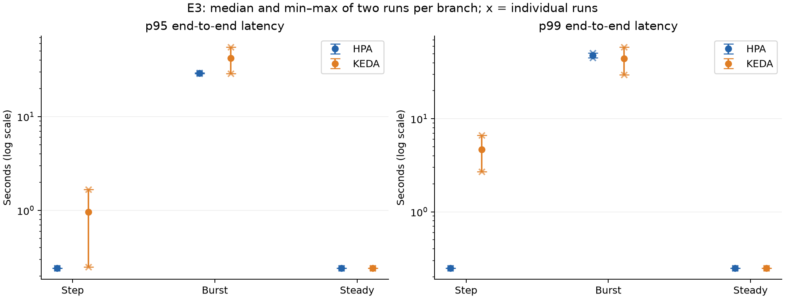
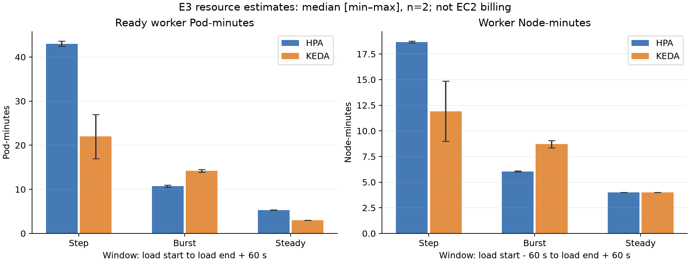
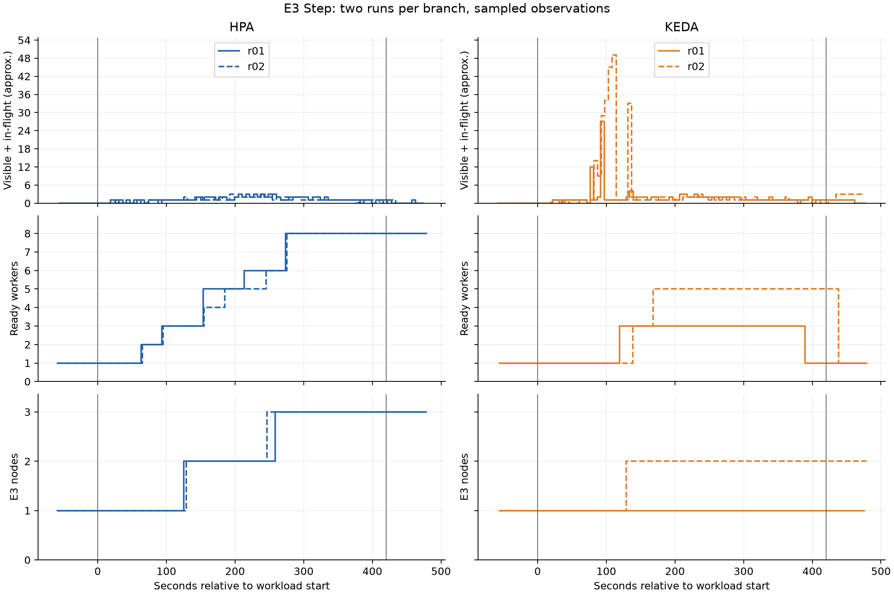
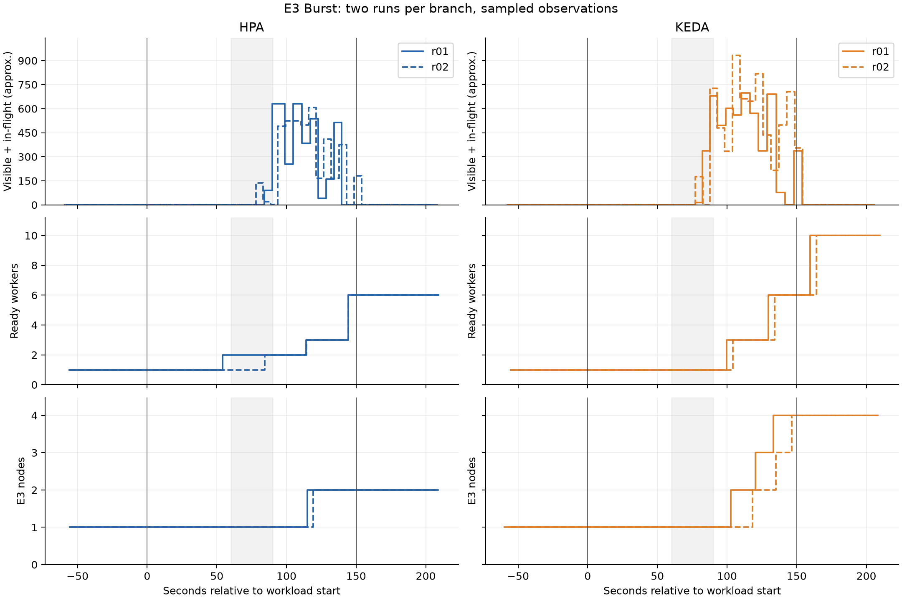
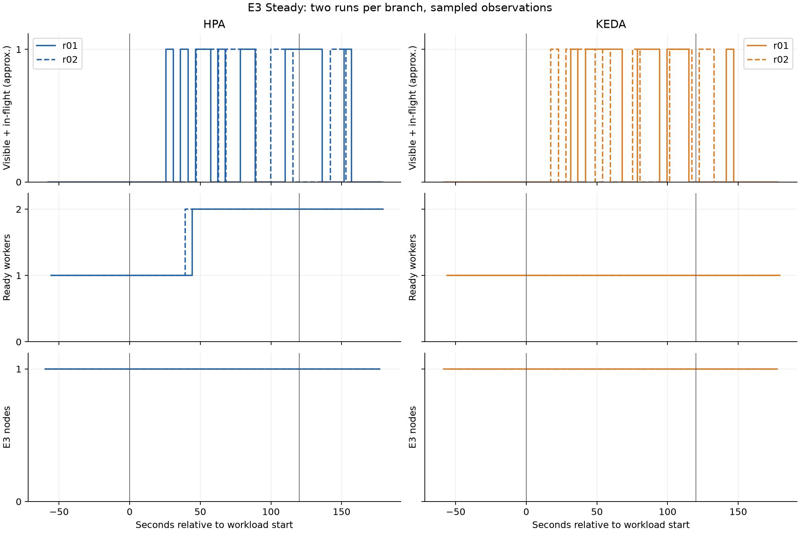

# E3 — Báo cáo hoàn thành CPU-HPA và KEDA trên Karpenter

Đã hoàn thành **12 lượt đo**: hai lượt mỗi nhánh HPA/KEDA cho từng workload, theo thứ tự Step → Burst → Steady. Các lượt được giữ để phân tích hiệu năng có giới hạn; chưa đối soát job ID và không khẳng định ý nghĩa thống kê từ n=2.

## Thiết kế và cách thực hiện

- Mỗi lượt bắt đầu đúng một node E3 và một worker Ready; giữ node gốc ip-10-0-11-127.ec2.internal, c7i-flex.large On-Demand, us-east-1b. Capacity thêm được thu hồi ngoài cửa sổ đo sau khi kiểm tra không có ứng dụng cần giữ.
- HPA CPU target 60%; KEDA queueLength 10, scaleOnInFlight=true; cả hai min 1/max 10. Karpenter có thể tạo thêm node; consolidation Never.
- Worker request CPU 500m/memory 256Mi, memory limit 256Mi, concurrency 1, SQS_MAX_MESSAGES 1, cùng image digest. Chart runtime trích từ Helm revision 21 để giữ DB Secret, TLS CA và ServiceAccount; không dùng chart local thiếu tính năng.
- Batch 1, work_units 100, DB_MODE light, max VU 50. Step v4: 5→10→15→20→15→10→5 request/s, 420 giây; Burst v3: 5→40→5 request/s, 150 giây; Steady v3: 5 request/s, 120 giây.
- Node-minutes dùng cửa sổ từ 60 giây trước tải đến 60 giây sau tải. Ready Pod-minutes, latency và CPU dùng từ bắt đầu tải đến 60 giây sau tải; throughput chỉ dùng thời gian phát tải. Giữ cùng định nghĩa cho mọi lượt; không chia Pod-minutes cho Node-minutes để suy ra mật độ Pod trung bình vì khác cửa sổ. Collector tự chạy tiếp đến khi đủ tail và có ba mẫu SQS rỗng liên tiếp. Các lượt tự chạy thu ít nhất 75 giây baseline. HPA Step r02 thủ công có khoảng 69,8 giây, đủ cửa sổ 60 giây nhưng lệch hướng dẫn 75 giây.
- Các lượt tự chạy reset worker ngoài cửa sổ đo, chờ warm-up 30 giây trước controller; Pod/uptime/cache có thể khác các lượt thủ công dù cùng node. Không coi cùng node là bằng chứng kiểm soát hoàn toàn mọi biến nền.

## Step — trung vị [min–max], n=2 mỗi nhánh

| Chỉ số | HPA | KEDA |
|---|---:|---:|
| Throughput success ≈ task/s | 11.190 [11.180–11.200] | 11.200 [11.170–11.230] |
| p95 E2E ≈ s | 0.2430 [0.2430–0.2430] | 0.9585 [0.2490–1.6680] |
| p99 E2E ≈ s | 0.2490 [0.2490–0.2490] | 4.6850 [2.7090–6.6610] |
| Peak queue ≈ | 3.000 [3.000–3.000] | 38.000 [27.000–49.000] |
| Xác nhận drain ≈ s | 22.700 [19.600–25.800] | 71.350 [52.000–90.700] |
| Ready Pod-minutes ≈ | 43.005 [42.410–43.600] | 22.000 [17.000–27.000] |
| Worker Node-minutes ≈ | 18.675 [18.600–18.750] | 11.925 [9.000–14.850] |

Theo trung vị, KEDA giảm khoảng 48.8% Ready Pod-minutes và giảm khoảng 36.1% Worker Node-minutes so với HPA trong profile này. Đây là proxy tài nguyên trong cửa sổ, không phải tiết kiệm hóa đơn AWS. Cần đọc kèm độ trễ, backlog và các lượt riêng.

## Burst — trung vị [min–max], n=2 mỗi nhánh

| Chỉ số | HPA | KEDA |
|---|---:|---:|
| Throughput success ≈ task/s | 11.520 [11.480–11.560] | 10.575 [10.560–10.590] |
| p95 E2E ≈ s | 29.1520 [28.9190–29.3850] | 42.0305 [28.7020–55.3590] |
| p99 E2E ≈ s | 48.1405 [45.2910–50.9900] | 44.4265 [29.7810–59.0720] |
| Peak queue ≈ | 620.000 [608.000–632.000] | 814.500 [698.000–931.000] |
| Xác nhận drain ≈ s | 34.850 [27.700–42.000] | 24.700 [16.300–33.100] |
| Ready Pod-minutes ≈ | 10.745 [10.500–10.990] | 14.225 [13.900–14.550] |
| Worker Node-minutes ≈ | 6.055 [6.020–6.090] | 8.705 [8.340–9.070] |

Theo trung vị, KEDA tăng khoảng 32.4% Ready Pod-minutes và tăng khoảng 43.8% Worker Node-minutes so với HPA trong profile này. Đây là proxy tài nguyên trong cửa sổ, không phải tiết kiệm hóa đơn AWS. Cần đọc kèm độ trễ, backlog và các lượt riêng.

## Steady — trung vị [min–max], n=2 mỗi nhánh

| Chỉ số | HPA | KEDA |
|---|---:|---:|
| Throughput success ≈ task/s | 4.575 [4.530–4.620] | 4.705 [4.600–4.810] |
| p95 E2E ≈ s | 0.2425 [0.2420–0.2430] | 0.2430 [0.2430–0.2430] |
| p99 E2E ≈ s | 0.2485 [0.2480–0.2490] | 0.2490 [0.2490–0.2490] |
| Peak queue ≈ | 1.000 [1.000–1.000] | 1.000 [1.000–1.000] |
| Xác nhận drain ≈ s | 18.800 [11.200–26.400] | 17.100 [10.800–23.400] |
| Ready Pod-minutes ≈ | 5.310 [5.270–5.350] | 3.000 [3.000–3.000] |
| Worker Node-minutes ≈ | 4.000 [4.000–4.000] | 4.000 [4.000–4.000] |

Theo trung vị, KEDA giảm khoảng 43.5% Ready Pod-minutes và xấp xỉ ngang nhau về Worker Node-minutes so với HPA trong profile này. Đây là proxy tài nguyên trong cửa sổ, không phải tiết kiệm hóa đơn AWS. Cần đọc kèm độ trễ, backlog và các lượt riêng.

## Đánh giá dữ liệu và giới hạn

- Tất cả report đã được kiểm tra điều kiện đầu, thời lượng, k6, queue/DLQ, image và lỗi nguồn thu; audit.json lưu các cờ kiểm tra. Trường validity trong report.json vẫn là mặc định của công cụ; phần đánh giá nằm trong audit/notes/report.md.
- Counter success là delta từ mẫu; phần đầu series mới và phần cuối Pod ngắn có thể thiếu. Bảng dưới ghi rõ phần chênh, chưa thay đối soát job ID. Không thay success bằng accepted và không khẳng định không mất/trùng job.
- Percentile là nội suy histogram có thể gồm nhiều status; histogram cũng là counter theo Pod nên có thể thiếu đầu/cuối series như counter success. Trung vị hai giá trị p95 là thống kê giữa các lượt, không phải p95 gộp job. Hai giá trị bằng nhau sau làm tròn không chứng minh cùng phân phối.
- Queue SQS gần đúng và chu kỳ thực tế có thể dài hơn 5 giây; query step không tăng scrape resolution. Mốc drain là xác nhận qua mẫu, không phải timestamp job cuối hoàn thành. Mốc scale-out trong Prometheus cũng có thể muộn hơn raw worker; không coi query step 5 giây là thời điểm quyết định chính xác. Pending/node thay đổi được đối chiếu scheduler/NodeClaim; không tự làm lượt vô hiệu.
- Node-minutes là node Kubernetes hiện diện, không phải EC2 billing; không gồm toàn bộ thời gian chuẩn bị/giữ node. CPU là tổng worker ước lượng từ counter, không phải CPU mỗi Pod. Hai ngưỡng controller được chọn không đại diện mọi cách tuning.

| Run ID | Accepted | Success delta đến drain đầu | Bổ sung đầu series | Còn chênh | Drain đầu ngoài tail |
|---|---:|---:|---:|---:|---|
| [E3-hpa-step-r01](../results/E3/E3-hpa-step-r01/report.md) | 4799 | 4726.0 | 73.0 | 0.0 | False |
| [E3-keda-step-r01](../results/E3/E3-keda-step-r01/report.md) | 4799 | 4741.0 | 48.0 | 10.0 | False |
| [E3-keda-step-r02](../results/E3/E3-keda-step-r02/report.md) | 4799 | 4707.0 | 88.0 | 4.0 | True |
| [E3-hpa-step-r02](../results/E3/E3-hpa-step-r02/report.md) | 4799 | 4738.0 | 61.0 | 0.0 | False |
| [E3-hpa-burst-r01](../results/E3/E3-hpa-burst-r01/report.md) | 1799 | 1742.0 | 44.0 | 13.0 | False |
| [E3-keda-burst-r01](../results/E3/E3-keda-burst-r01/report.md) | 1799 | 1599.0 | 200.0 | 0.0 | False |
| [E3-keda-burst-r02](../results/E3/E3-keda-burst-r02/report.md) | 1799 | 1611.0 | 188.0 | 0.0 | False |
| [E3-hpa-burst-r02](../results/E3/E3-hpa-burst-r02/report.md) | 1800 | 1759.0 | 41.0 | 0.0 | False |
| [E3-hpa-steady-r01](../results/E3/E3-hpa-steady-r01/report.md) | 600 | 574.0 | 26.0 | 0.0 | False |
| [E3-keda-steady-r01](../results/E3/E3-keda-steady-r01/report.md) | 599 | 582.0 | 17.0 | 0.0 | False |
| [E3-keda-steady-r02](../results/E3/E3-keda-steady-r02/report.md) | 599 | 592.0 | 7.0 | 0.0 | False |
| [E3-hpa-steady-r02](../results/E3/E3-hpa-steady-r02/report.md) | 599 | 577.0 | 22.0 | 0.0 | False |

Các lượt có drain ngoài tail: percentile và nhiều metric hiệu năng chỉ bao phủ cửa sổ cố định, không mô tả toàn bộ thời gian đến drain. Số success đến drain được tính riêng nhưng vẫn có giới hạn counter.

Cột drain của công cụ là lần đầu có ba mẫu rỗng liên tiếp, không bảo đảm queue sẽ không xuất hiện lại. Một số lượt có mẫu SQS khác 0 sau mốc đó; không gán nguyên nhân khi chưa đối soát job. Collector tự chạy chờ ba mẫu rỗng ở cuối dữ liệu; cuối mọi lượt queue/DLQ rỗng. Bảng sau bổ sung kiểm tra raw, giữ nguyên report.json để so sánh nhất quán.

| Run có mẫu khác 0 sau drain đầu | Số mẫu | Mẫu khác 0 cuối sau tải ≈ s | Xác nhận chuỗi rỗng cuối ≈ s |
|---|---:|---:|---:|
| E3-hpa-step-r01 | 1 | 37.1 | 54.4 |
| E3-hpa-steady-r01 | 1 | 31.5 | 47.6 |
| E3-keda-steady-r01 | 1 | 21.4 | 37.2 |
| E3-hpa-steady-r02 | 2 | 27.6 | 43.7 |

## Kết luận phạm vi E3

Đã thu đủ hai lượt cho mỗi tổ hợp theo kế hoạch. Kết quả thể hiện trade-off của chính cấu hình CPU-HPA 60% và KEDA queue target 10 trong từng workload; không khái quát một controller luôn tốt hơn hoặc luôn tiết kiệm hơn. Sử dụng bảng từng profile và min–max khi viết đồ án; không coi n=2 là chứng cứ thống kê mạnh.

Nguồn: report.json, collection.json, audit.json, k6 summary, raw metrics/events và notes của từng lượt; bảng comparison-step/burst/steady-complete.md trong experiments/results/E3. Các file PNG/SVG trong figures dùng được để đưa vào báo cáo/slides.

Đã khôi phục E1 trước E3: worker 3/3 Ready, API 2/2 Ready; không còn node/NodeClaim E3 hoặc EC2 E3 hoạt động. Chi tiết kiểm chứng: [CLEANUP.md](CLEANUP.md).
