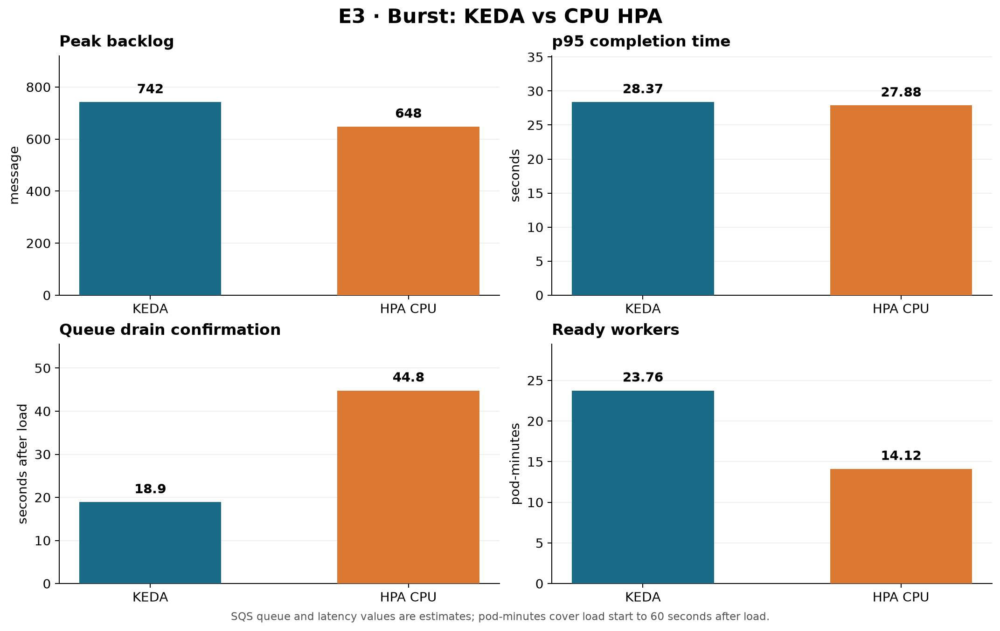
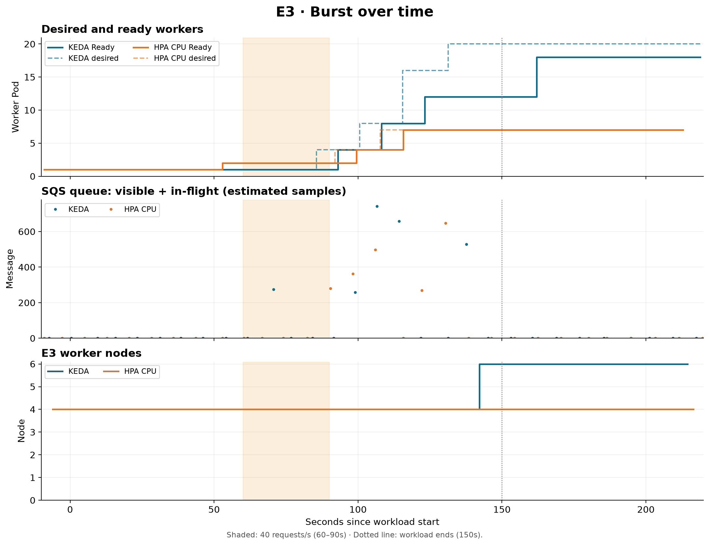

# E3 — CPU-HPA vs KEDA trên Karpenter

## Mục tiêu

So sánh phản ứng, hiệu năng và tài nguyên của HPA theo CPU với KEDA theo queue trên cùng workload.

## Thiết kế

Mỗi lượt bắt đầu với một worker Ready và 4 node worker được giữ sẵn. Hai nhánh dùng cùng workload, min 1/max 20 worker; HPA có CPU target 60%, KEDA có queueLength 10. NodePool không consolidation trong quá trình đo.

So sánh dùng workload Burst: 5 request/s trong 60 giây, 40 request/s trong 30 giây và 5 request/s trong 60 giây.

## Cấu hình và workload

| File | Chức năng |
|---|---|
| `karpenter-values.yaml`, `warm-capacity.yaml` | NodePool `e3-orders` dùng `t3.small`, không consolidation; 4 Pod tạm tạo 4 node |
| `autoscaled-values.yaml` | Worker chọn NodePool E3, CPU request 500m, memory request 256Mi |
| `hpa.yaml`, `keda.yaml` | HPA CPU target 60%, hoặc KEDA SQS queueLength 10; cả hai min 1/max 20 |
| `stead.js`, `step.js`, `burst.js`, `workload-common.js` | Steady 5/s 2 phút; Step 5→10→15→20→15→10→5/s, mỗi bậc 1 phút; Burst 5/s 1 phút → 40/s 30 giây → 5/s 1 phút |
| `run.py`, `run.sh`, `collect.py` | Hồ sơ, lệnh tắt và thu SQS, Prometheus, Pod, NodeClaim, node và event |
| `report.py`, `compare.py` | Báo cáo từng lượt và so sánh HPA/KEDA cùng profile/cửa sổ |

CPU request 500m khác 128m của E0; HPA target 60% được tính theo request này. Kiểm tra CPU, memory, Pod/IP trống, loại node và image cache tương đương giữa hai nhánh. Ghi nhận Pod Pending và node mới trong cửa sổ đo để phân tích tác động của provisioning. KEDA/Karpenter, API và monitoring cần node hệ thống độc lập. Kiểm tra quota, IAM, subnet và chi phí.

Trước mỗi lượt, chuẩn bị 4 node Ready, xóa các Pod giữ chỗ và bắt đầu với một worker. Giữ điều kiện node tương đương giữa hai nhánh.

## Kết quả Burst

Hai nhánh bắt đầu với cùng 4 node `t3.small`, 1 worker Ready, cùng image và workload. Mỗi nhánh ghi nhận 1.799 job được API chấp nhận và không có request lỗi theo k6.

| Chỉ số | KEDA | HPA CPU |
|---|---:|---:|
| Peak queue visible + in-flight ≈ (message) | 742 | 648 |
| p50 E2E ≈ (giây) | 12,77 | 9,26 |
| p95 E2E ≈ (giây) | 28,37 | 27,88 |
| Xác nhận queue drain sau tải ≈ (giây) | 18,9 | 44,8 |
| Throughput thành công trong tải ≈ (job/giây) | 9,78 | 10,89 |
| Worker Ready ≈ (Pod-phút) | 23,76 | 14,12 |
| Node worker ≈ (node-phút) | 20,27 | 18,00 |
| Pod Pending / node bổ sung | Có / 2 | Không quan sát / 0 |

HPA có peak queue thấp hơn khoảng 13% và dùng ít Pod-phút hơn khoảng 41%; p95 của hai nhánh gần nhau. KEDA có thời điểm xác nhận queue drain sớm hơn, đồng thời yêu cầu nhiều worker hơn và tạo thêm 2 node.

Theo mẫu Pod, HPA có 2 worker Ready trước pha tải cao và sau đó đạt 7 worker Ready. KEDA tăng desired lên 20; một số Pod Pending khi 4 node ban đầu không còn đủ capacity, và Karpenter bổ sung 2 node. Kết quả phản ánh cả phản ứng của autoscaler và thời gian bổ sung node.

Queue SQS và các phân vị là giá trị xấp xỉ; các mẫu queue có dao động. Pod-phút tính từ đầu tải đến 60 giây sau tải; node-phút còn tính thêm 60 giây trước tải và không phải chi phí EC2. Counter success có thể thiếu phần xử lý trước mẫu đầu của Pod mới; queue và DLQ rỗng ở snapshot cuối, nhưng chưa đối soát từng job ID.

Có thể tạo lại biểu đồ bằng `python experiments/E3/plot_e3.py` sau khi cài `matplotlib`.
