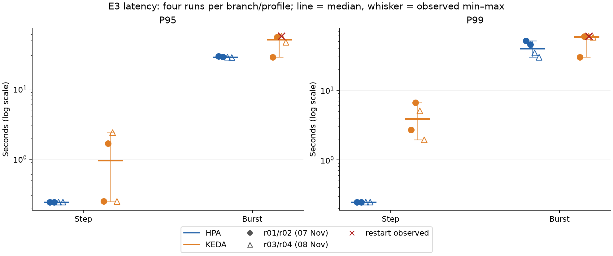
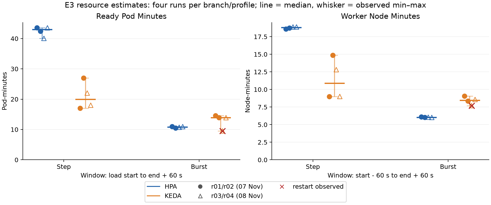
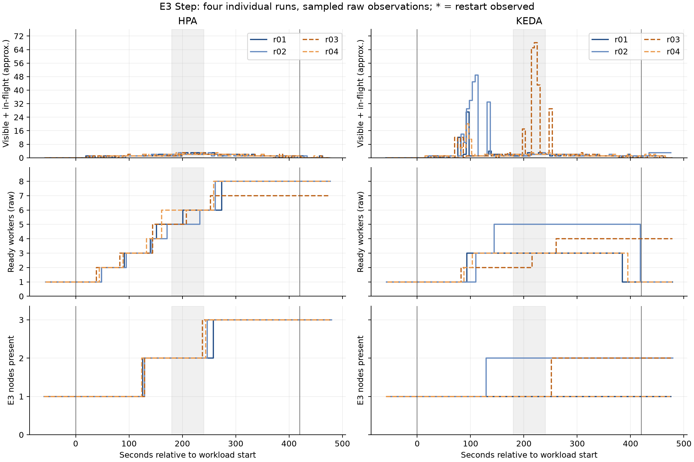
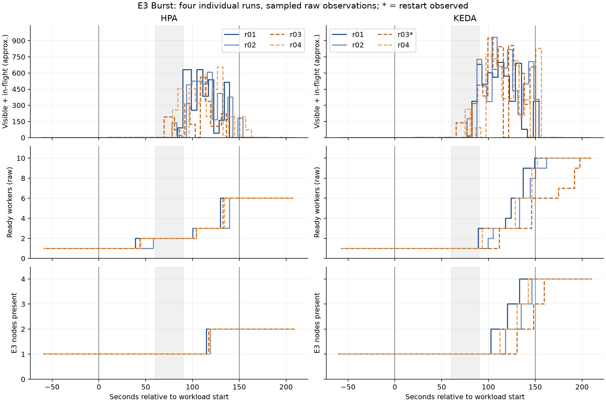

# E3 — Step/Burst sau khi bổ sung r03–r04

Đã hoàn thành tám lượt mới ngày 08/11/2026. Mỗi tổ hợp HPA/KEDA × Step/Burst hiện có bốn lượt; Steady giữ hai lượt mỗi nhánh. Tổng hồ sơ E3 hoàn tất là 20 lượt. Các số dưới đây là ước lượng, chưa đối soát job ID và n=4 chưa đủ khẳng định khác biệt có ý nghĩa thống kê.

## Điều kiện và hai đợt đo

Giữ HPA CPU target 60%, KEDA queueLength 10/scaleOnInFlight=true, min=1/max=10, CPU request500m, memory256Mi, concurrency1, batch1, work_units100, DB light, maxVU50 và cùng digest. Workload/chart/controller/tool thu giữ checksum như đợt gốc. Mỗi lượt bắt đầu một worker và một node Ready; capacity thêm được thu hồi giữa các lượt. Node đầu mới giữ c7i-flex.large/us-east-1b/AMI đã chọn; ID/uptime/cache/ngày và tải nền có thể khác đợt 07/11. Không coi bốn lượt là bốn phép đo cùng node vật lý.

Các lượt mới có baseline75 giây, tail≥60 giây và tiếp tục đến khi ba mẫu SQS rỗng cuối liên tiếp. Giữ định nghĩa report gốc: Node-minutes từ trước tải60s đến sau tải60s; Pod-minutes/latency/CPU từ đầu tải đến sau tải60s; throughput trong tải. Các lượt có drain ngoài tail cần đọc giới hạn percentile.

## Step — trung vị [min–max], n=4 mỗi nhánh

| Chỉ số | HPA | KEDA |
|---|---:|---:|
| p95 E2E ≈ s | 0.2430 [0.2430–0.2430] | 0.9585 [0.2480–2.3920] |
| p99 E2E ≈ s | 0.2490 [0.2490–0.2490] | 3.8865 [1.9460–6.6610] |
| Throughput success ≈ job/s | 11.190 [11.150–11.200] | 11.240 [11.170–11.290] |
| Peak queue ≈ | 3.000 [3.000–3.000] | 38.000 [20.000–68.000] |
| Drain đầu ≈ s | 17.400 [13.300–25.800] | 54.350 [51.600–90.700] |
| Ready Pod-minutes ≈ | 42.965 [40.050–43.600] | 20.005 [17.000–27.000] |
| Worker Node-minutes ≈ | 18.815 [18.600–18.880] | 10.905 [9.000–14.850] |

| Run | Accepted | p95 ≈ s | p99 ≈ s | Peak queue | Worker/node peak | Pod-min | Node-min |
|---|---:|---:|---:|---:|---|---:|---:|
| [E3-hpa-step-r01](../results/E3/E3-hpa-step-r01/report.md) | 4799 | 0.243 | 0.249 | 3 | 8/3 | 43.60 | 18.60 |
| [E3-hpa-step-r02](../results/E3/E3-hpa-step-r02/report.md) | 4799 | 0.243 | 0.249 | 3 | 8/3 | 42.41 | 18.75 |
| [E3-hpa-step-r03](../results/E3/E3-hpa-step-r03/report.md) | 4799 | 0.243 | 0.249 | 3 | 7/3 | 40.05 | 18.88 |
| [E3-hpa-step-r04](../results/E3/E3-hpa-step-r04/report.md) | 4799 | 0.243 | 0.249 | 3 | 8/3 | 43.52 | 18.88 |
| [E3-keda-step-r01](../results/E3/E3-keda-step-r01/report.md) | 4799 | 0.249 | 2.709 | 27 | 3/1 | 17.00 | 9.00 |
| [E3-keda-step-r02](../results/E3/E3-keda-step-r02/report.md) | 4799 | 1.668 | 6.661 | 49 | 5/2 | 27.00 | 14.85 |
| [E3-keda-step-r03](../results/E3/E3-keda-step-r03/report.md) | 4799 | 2.392 | 5.064 | 68 | 4/2 | 22.01 | 12.81 |
| [E3-keda-step-r04](../results/E3/E3-keda-step-r04/report.md) | 4799 | 0.248 | 1.946 | 20 | 3/1 | 18.00 | 9.00 |

| Nhánh | p95 trung vị đợt r01/r02 | p95 trung vị đợt r03/r04 | p99 trung vị đợt r01/r02 | p99 trung vị đợt r03/r04 |
|---|---:|---:|---:|---:|
| HPA | 0.2430 | 0.2430 | 0.2490 | 0.2490 |
| KEDA | 0.9585 | 1.3200 | 4.6850 | 3.5050 |

## Burst — trung vị [min–max], n=4 mỗi nhánh

| Chỉ số | HPA | KEDA |
|---|---:|---:|
| p95 E2E ≈ s | 28.7680 [28.3090–29.3850] | 51.0185 [28.7020–57.0020] |
| p99 E2E ≈ s | 39.7680 [29.6620–50.9900] | 58.2040 [29.7810–59.4000] |
| Throughput success ≈ job/s | 11.550 [11.480–11.620] | 10.575 [10.460–10.900] |
| Peak queue ≈ | 620.000 [561.000–655.000] | 876.500 [698.000–931.000] |
| Drain đầu ≈ s | 29.300 [14.900–42.000] | 36.650 [16.300–42.900] |
| Ready Pod-minutes ≈ | 10.835 [10.500–10.990] | 13.895 [9.530–14.550] |
| Worker Node-minutes ≈ | 6.035 [6.020–6.090] | 8.455 [7.700–9.070] |

| Run | Accepted | p95 ≈ s | p99 ≈ s | Peak queue | Worker/node peak | Pod-min | Node-min |
|---|---:|---:|---:|---:|---|---:|---:|
| [E3-hpa-burst-r01](../results/E3/E3-hpa-burst-r01/report.md) | 1799 | 29.385 | 50.990 | 632 | 6/2 | 10.99 | 6.09 |
| [E3-hpa-burst-r02](../results/E3/E3-hpa-burst-r02/report.md) | 1800 | 28.919 | 45.291 | 608 | 6/2 | 10.50 | 6.02 |
| [E3-hpa-burst-r03](../results/E3/E3-hpa-burst-r03/report.md) | 1799 | 28.617 | 34.245 | 561 | 6/2 | 10.73 | 6.05 |
| [E3-hpa-burst-r04](../results/E3/E3-hpa-burst-r04/report.md) | 1799 | 28.309 | 29.662 | 655 | 6/2 | 10.94 | 6.02 |
| [E3-keda-burst-r01](../results/E3/E3-keda-burst-r01/report.md) | 1799 | 28.702 | 29.781 | 698 | 10/4 | 14.55 | 9.07 |
| [E3-keda-burst-r02](../results/E3/E3-keda-burst-r02/report.md) | 1799 | 55.359 | 59.072 | 931 | 10/4 | 13.90 | 8.34 |
| [E3-keda-burst-r03](../results/E3/E3-keda-burst-r03/report.md) | 1799 | 57.002 | 59.400 | 924 | 10/4 | 9.53 | 7.70 |
| [E3-keda-burst-r04](../results/E3/E3-keda-burst-r04/report.md) | 1799 | 46.678 | 57.336 | 829 | 10/4 | 13.89 | 8.57 |

| Nhánh | p95 trung vị đợt r01/r02 | p95 trung vị đợt r03/r04 | p99 trung vị đợt r01/r02 | p99 trung vị đợt r03/r04 |
|---|---:|---:|---:|---:|
| HPA | 29.1520 | 28.4630 | 48.1405 | 31.9535 |
| KEDA | 42.0305 | 51.8400 | 44.4265 | 58.3680 |

## Đối chiếu percentile với bucket gốc

Histogram E2E có bucket 15–30 và 30–60 giây. p99 nội suy có thể thay đổi nhiều khi tỷ lệ vượt30 giây thay đổi; không coi số lẻ mili giây là đo chính xác. Bảng này dùng cùng delta bucket và cửa sổ với report gốc, vẫn chịu giới hạn thiếu đầu/cuối series. Tỷ lệ là của các observation trong delta thu được, không phải đối soát toàn bộ accepted job.

| Run | Observation delta | ≤1s ≈ % | ≤5s ≈ % | >30s ≈ % | Bucket chứa p99 |
|---|---:|---:|---:|---:|---|
| E3-hpa-step-r01 | 4726.0 | 100.00 | 100.00 | 0.00 | 0.1–0.25s |
| E3-hpa-step-r02 | 4738.0 | 100.00 | 100.00 | 0.00 | 0.1–0.25s |
| E3-hpa-step-r03 | 4724.0 | 100.00 | 100.00 | 0.00 | 0.1–0.25s |
| E3-hpa-step-r04 | 4704.0 | 100.00 | 100.00 | 0.00 | 0.1–0.25s |
| E3-keda-step-r01 | 4741.0 | 97.36 | 99.83 | 0.02 | 2.5–5s |
| E3-keda-step-r02 | 4707.0 | 93.90 | 98.53 | 0.06 | 5–10s |
| E3-keda-step-r03 | 4739.0 | 90.93 | 98.99 | 0.00 | 5–10s |
| E3-keda-step-r04 | 4751.0 | 98.19 | 99.96 | 0.02 | 1–2.5s |
| E3-hpa-burst-r01 | 1742.0 | 25.72 | 34.73 | 3.33 | 30–60s |
| E3-hpa-burst-r02 | 1716.0 | 26.52 | 34.32 | 2.04 | 30–60s |
| E3-hpa-burst-r03 | 1717.0 | 26.91 | 35.70 | 1.16 | 30–60s |
| E3-hpa-burst-r04 | 1750.0 | 26.46 | 34.86 | 0.00 | 15–30s |
| E3-keda-burst-r01 | 1599.0 | 28.39 | 32.83 | 0.19 | 15–30s |
| E3-keda-burst-r02 | 1609.0 | 24.49 | 28.53 | 32.32 | 30–60s |
| E3-keda-burst-r03 | 1575.0 | 22.03 | 26.22 | 50.03 | 30–60s |
| E3-keda-burst-r04 | 1643.0 | 25.99 | 29.58 | 11.26 | 30–60s |

Không dùng chênh lệch p99 nội suy riêng lẻ để suy ra chênh thời gian thực chính xác của những job chậm nhất.

## Backlog xuất hiện ở bậc tải nào?

Các mốc sau lấy từ raw, không phải timestamp quyết định chính xác. Với Step, bậc 20 job/s bắt đầu tại giây180; với Burst, bậc40 bắt đầu tại giây60. Vùng tô xám trên timeline là bậc cao nhất. Số worker sẵn trước bậc cao có thể khác nhau do phản ứng với các bậc trước.

| Run | Ready trong mẫu cuối trước bậc cao | Peak queue tại ≈ s | Bậc tại mẫu peak | Node bổ sung Ready đầu ≈ s |
|---|---:|---:|---|---:|
| E3-hpa-step-r01 | 5 | 205.0 | 20 job/s | 136.5 |
| E3-hpa-step-r02 | 5 | 192.2 | 20 job/s | 139.7 |
| E3-hpa-step-r03 | 5 | 200.1 | 20 job/s | 140.7 |
| E3-hpa-step-r04 | 6 | 188.3 | 20 job/s | 129.5 |
| E3-keda-step-r01 | 3 | 91.9 | 10 job/s | Không thêm node |
| E3-keda-step-r02 | 5 | 108.7 | 10 job/s | 140.9 |
| E3-keda-step-r03 | 2 | 219.4 | 20 job/s | 257.0 |
| E3-keda-step-r04 | 3 | 91.5 | 10 job/s | Không thêm node |
| E3-hpa-burst-r01 | 2 | 89.9 | 40 job/s | 126.4 |
| E3-hpa-burst-r02 | 2 | 115.9 | 5 job/s | 135.7 |
| E3-hpa-burst-r03 | 2 | 108.4 | 5 job/s | 128.7 |
| E3-hpa-burst-r04 | 2 | 126.8 | 5 job/s | 130.8 |
| E3-keda-burst-r01 | 1 | 110.2 | 5 job/s | 114.3 |
| E3-keda-burst-r02 | 1 | 103.8 | 5 job/s | 129.4 |
| E3-keda-burst-r03 | 1 | 99.3 | 5 job/s | 142.4 |
| E3-keda-burst-r04 | 1 | 150.7 | sau tải | 124.7 |

Khác biệt peak giữa các lượt có thể xuất hiện ở các bậc khác nhau; không mặc định mọi latency cao đều do cùng một lần scale-out. Các mốc node Ready gồm cả độ trễ phát hiện, ra quyết định, scheduling và provisioning; không diễn giải thành thời gian boot EC2 riêng.

## Nhận xét từ bốn lượt mỗi nhánh

**Step:** HPA p95 trung vị 0.2430s [0.243–0.243], KEDA 0.9585s [0.248–2.392]. p99 trung vị tương ứng 0.2490s và 3.8865s.
Theo trung vị, KEDA giảm khoảng 53.4% Pod-minutes và giảm khoảng 42.0% Node-minutes. Đây là tài nguyên trong cửa sổ, không phải phần trăm hóa đơn AWS.
Khoảng min–max p95 quan sát của KEDA rộng hơn HPA trong bốn lượt này; chưa phải kiểm định khác biệt thống kê.

**Burst:** HPA p95 trung vị 28.7680s [28.309–29.385], KEDA 51.0185s [28.702–57.002]. p99 trung vị tương ứng 39.7680s và 58.2040s.
Theo trung vị, KEDA tăng khoảng 28.2% Pod-minutes và tăng khoảng 40.1% Node-minutes. Đây là tài nguyên trong cửa sổ, không phải phần trăm hóa đơn AWS.
Khoảng min–max p95 quan sát của KEDA rộng hơn HPA trong bốn lượt này; chưa phải kiểm định khác biệt thống kê.

Hai lượt bổ sung làm rõ phân bố kết quả, không bảo đảm độ biến thiên sẽ giảm. Giữ riêng số từng lượt và bảng hai đợt; không dùng một trung vị để che lượt chậm hoặc diễn giải các ngưỡng CPU60%/queue10 là hai cấu hình đã tối ưu theo cùng SLO.

### Trường hợp có restart và kiểm tra độ nhạy

Các lượt có restart vẫn được giữ trong bảng chính như quan sát hệ thống. Không coi chúng là chỉ khác controller trong điều kiện vận hành hoàn toàn tương đương. Dấu × đỏ trên biểu đồ chỉ trường hợp có restart; thống kê loại các trường hợp này dưới đây là kiểm tra độ nhạy, không thay bộ dữ liệu chính hoặc chứng minh quan hệ nhân quả. Ready Pod-minutes có thể thấp khi Pod chậm Ready/restart; không coi một lượt có Ready Pod-minutes thấp là hiệu quả hơn nếu bỏ qua latency, Pending và Node-minutes.

- E3-keda-burst-r03: restartCount quan sát tối đa 2; xem report/notes và evidence của lượt.

| Profile/nhánh | n tất cả / không ghi nhận restart | p95 trung vị tất cả / không restart ≈ s | p99 trung vị tất cả / không restart ≈ s |
|---|---:|---:|---:|
| step/hpa | 4/4 | 0.2430/0.2430 | 0.2490/0.2490 |
| step/keda | 4/4 | 0.9585/0.9585 | 3.8865/3.8865 |
| burst/hpa | 4/4 | 28.7680/28.7680 | 39.7680/39.7680 |
| burst/keda | 4/3 | 51.0185/46.6780 | 58.2040/57.3360 |

Riêng KEDA Burst r03: ba Pod trên cùng node mới có restart được quan sát đầu tiên ở khoảng giây169, sau khi tải k6 kết thúc khoảng19 giây. Event ghi health probe connection refused và BackOff; không có exit code/previous logs trước khi Pod reset để xác định nguyên nhân gốc. Không gán toàn bộ latency cao của lượt cho các restart này. [Evidence](../results/E3/E3-keda-burst-r03/events/repeat-restart-review.json).

## Audit và giới hạn

| Run | Critical flags | Còn chênh accepted sau bổ sung đầu counter | Drain ngoài tail | Mẫu SQS khác 0 sau drain đầu |
|---|---|---:|---|---:|
| E3-hpa-step-r01 | [] | 0.0 | False | 1 |
| E3-hpa-step-r02 | [] | 0.0 | False | 0 |
| E3-hpa-step-r03 | [] | 0.0 | False | 1 |
| E3-hpa-step-r04 | [] | 0.0 | False | 1 |
| E3-keda-step-r01 | [] | 10.0 | False | 0 |
| E3-keda-step-r02 | [] | 4.0 | True | 0 |
| E3-keda-step-r03 | [] | 0.0 | False | 0 |
| E3-keda-step-r04 | [] | 4.0 | False | 0 |
| E3-hpa-burst-r01 | [] | 13.0 | False | 0 |
| E3-hpa-burst-r02 | [] | 0.0 | False | 0 |
| E3-hpa-burst-r03 | [] | 0.0 | False | 1 |
| E3-hpa-burst-r04 | [] | 0.0 | False | 0 |
| E3-keda-burst-r01 | [] | 0.0 | False | 0 |
| E3-keda-burst-r02 | [] | 0.0 | False | 0 |
| E3-keda-burst-r03 | [] | 0.0 | False | 0 |
| E3-keda-burst-r04 | [] | 0.0 | False | 0 |

Giữ mọi lượt đạt audit, không bỏ các lượt có latency cao chỉ để giảm độ biến thiên. Counter/histogram có thể thiếu đầu/cuối series; bổ sung đầu counter chỉ để chẩn đoán, chưa chứng minh không mất/trùng job. Drain là xác nhận gần đúng bằng mẫu SQS, có thể xuất hiện lại message sau chuỗi rỗng đầu. Node-minutes không phải EC2 billing. Trung vị p95 giữa các lượt không phải p95 gộp toàn bộ job.

## Khôi phục sau đo

Đã khôi phục đúng trạng thái E2 trước đợt bổ sung: worker desired/Ready=0/0, selector e2-orders, ScaledObject e2-orders-sqs min=0 và HPA của nó; API đủ replica Ready. Không còn node/NodeClaim hoặc EC2 E3 hoạt động. Không thu hồi node E2 có sẵn. Chi tiết [repeat-cleanup-20261108.json](../results/E3/repeat-cleanup-20261108.json).

Nguồn: [trạng thái tám lượt mới](REPEATS-STATUS.md), [compare Step](../results/E3/comparison-step-r01-r04.md), [compare Burst](../results/E3/comparison-burst-r01-r04.md), report/notes/audit/raw từng lượt. Báo cáo [đợt 12 lượt gốc](FINAL-REPORT.md) được giữ riêng.
