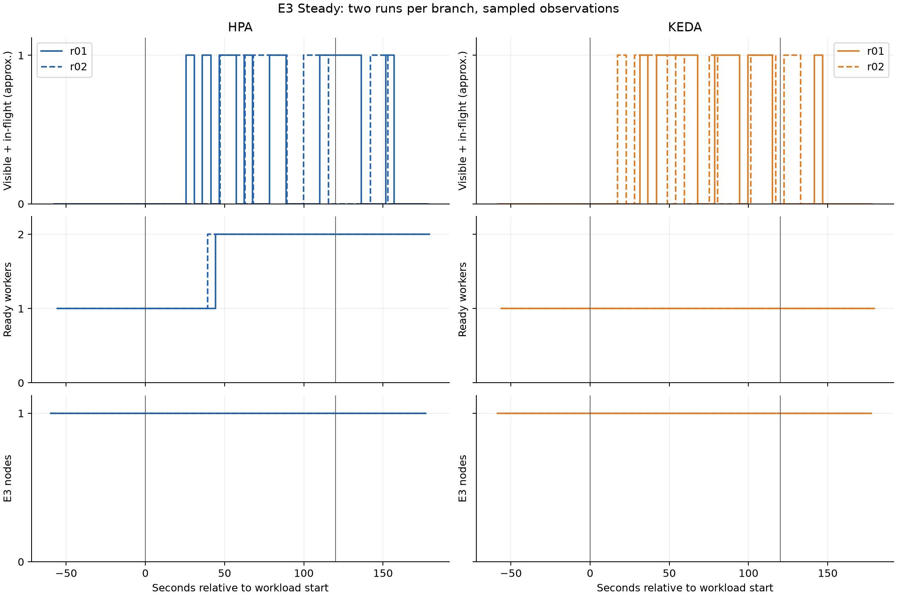

# E3 — CPU-HPA và KEDA, Steady hai lượt mỗi nhánh

Đã hoàn thành bốn lượt Steady v3: 5 request/s cố định trong 120 giây, batch=1, work_units=100, DB_MODE=light, max VU=50. Cùng node gốc, image digest và cấu hình worker như các profile khác; mỗi lượt bắt đầu một worker và một node E3 Ready.

| Lượt | Accepted | Throughput ≈ task/s | p95 ≈ s | p99 ≈ s | Peak queue ≈ | Peak worker/node | Ready Pod-min | Node-min |
|---|---:|---:|---:|---:|---:|---|---:|---:|
| [HPA r01](../results/E3/E3-hpa-steady-r01/report.md) | 600 | 4.530 | 0.243 | 0.249 | 1 | 2/1 | 5.27 | 4.00 |
| [KEDA r01](../results/E3/E3-keda-steady-r01/report.md) | 599 | 4.600 | 0.243 | 0.249 | 1 | 1/1 | 3.00 | 4.00 |
| [KEDA r02](../results/E3/E3-keda-steady-r02/report.md) | 599 | 4.810 | 0.243 | 0.249 | 1 | 1/1 | 3.00 | 4.00 |
| [HPA r02](../results/E3/E3-hpa-steady-r02/report.md) | 599 | 4.620 | 0.242 | 0.248 | 1 | 2/1 | 5.35 | 4.00 |

## Trung vị [min–max], n=2 mỗi nhánh

| Chỉ số | HPA | KEDA |
|---|---:|---:|
| Throughput ≈ task/s | 4.575 [4.530–4.620] | 4.705 [4.600–4.810] |
| p95 E2E ≈ s | 0.2425 [0.2420–0.2430] | 0.2430 [0.2430–0.2430] |
| p99 E2E ≈ s | 0.2485 [0.2480–0.2490] | 0.2490 [0.2490–0.2490] |
| Peak queue ≈ | 1.000 [1.000–1.000] | 1.000 [1.000–1.000] |
| Xác nhận drain ≈ s | 18.800 [11.200–26.400] | 17.100 [10.800–23.400] |
| Ready Pod-minutes ≈ | 5.310 [5.270–5.350] | 3.000 [3.000–3.000] |
| Worker Node-minutes ≈ | 4.000 [4.000–4.000] | 4.000 [4.000–4.000] |

## Đánh giá và giới hạn

Đọc số worker và Pod-minutes cùng latency để đánh giá lượng tài nguyên của từng controller ở tải thấp. Node-minutes có thể bằng nhau vì cả hai nhánh giữ sẵn một node; điều này không có nghĩa tổng chi phí AWS bằng nhau. So sánh này chỉ áp dụng cho 5 request/s và các ngưỡng controller đã chọn.

Bốn lượt không có critical flag trong audit. Các giá trị accepted khác nhau một request được giữ nguyên. Mỗi report/notes ghi số lỗi k6, DLQ, restart, counter và điều kiện đầu. Success delta và histogram có thể thiếu đầu/cuối series; phép bổ sung đầu counter chỉ để chẩn đoán, chưa thay đối soát job ID. Hai percentile bằng nhau sau làm tròn không chứng minh cùng phân phối. n=2 mỗi nhánh, chưa đủ khẳng định khác biệt thống kê. Drain trong report là lần đầu có ba mẫu rỗng; một số lượt có mẫu khác 0 sau đó. Xem bảng xác nhận chuỗi rỗng cuối trong báo cáo tổng hợp; cuối mọi lượt queue/DLQ rỗng.

Nguồn: [bảng compare Steady](../results/E3/comparison-steady-complete.md), [báo cáo tổng hợp](FINAL-REPORT.md) và dữ liệu raw/audit trong từng thư mục run.
