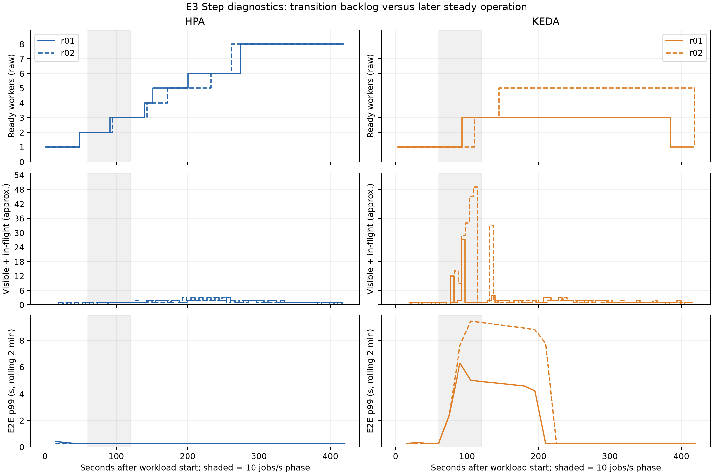

# Phân tích dữ liệu để tuning HPA/KEDA — bổ sung ngày 08/11/2026

Đã tự xuất lại đủ 18 query tại mốc E3-keda-step-r01 và đọc 144 truy vấn query-range cho đủ hai lượt HPA/KEDA của Step/Burst. Chỉ truy cập lịch sử Prometheus, không phát tải hoặc đổi cluster. Giữ nguyên 12 report gốc; các kết quả dưới đây là chẩn đoán bổ sung, chưa phải cấu hình đã tuning/được kiểm chứng.

## Kết quả tại 17:31:57 ngày 07/11/2026 (UTC+7)

Cửa sổ hai phút trước mốc này nằm qua hai bậc 15 và 20 job/s. Vì vậy published trung bình≈17,45 job/s, không phải cấu hình workload bị giảm từ 20 xuống 17,45.

| Đại lượng | Kết quả |
|---|---:|
| Published | 17.452 job/s |
| Success tổng | 17.452 job/s |
| Success mỗi Pod | 5.765–5.861 job/s |
| CPU tổng worker | 1635.2m |
| CPU mỗi Pod | 471.5–585.4m |
| CPU/request mỗi Pod | 94.3–117.1% |
| CPU/job, tổng CPU chia tổng success | 0.0937 CPU-giây/job |
| Thời gian xử lý trung bình mỗi Pod | 109.64–110.03 ms |
| Thời gian chờ trung bình mỗi Pod | 8.86–9.25 ms |
| p95 / p99 E2E | 242.64 / 248.65 ms |
| Desired / Ready / Pending | 3 / 3 / 0 |
| Phân bố | 3 worker cùng một node E3 |
| Scrape | 3/3 target UP; mỗi success series có 24 mẫu trong 2 phút |

KEDA đã xử lý kịp ở giai đoạn này với thời gian chờ thấp. Đây không phải phép đo μ bão hòa: lưu lượng đầu vào gần bằng đầu ra chỉ cho thấy đáp ứng được tải quan sát. CPU/request có thể vượt 100% vì CPU request không phải CPU limit; worker không có CPU limit. CPU từ cAdvisor khác nguồn/timing của CPU metrics-server mà HPA dùng.

## Step: điểm yếu xuất hiện ở chuyển tiếp đầu

| Run | Mẫu desired>1 đầu ≈ s | Mẫu Ready>1 đầu ≈ s | Peak queue ≈ | Peak queue tại ≈ s | p99 rolling tại giây 120 ≈ s | p99 rolling tại giây 240 ≈ s |
|---|---:|---:|---:|---:|---:|---:|
| E3-hpa-step-r01 | 43.1 | 48.5 | 3 | 205.0 | 0.249 | 0.249 |
| E3-hpa-step-r02 | 43.0 | 48.2 | 3 | 192.2 | 0.248 | 0.249 |
| E3-keda-step-r01 | 88.1 | 93.3 | 27 | 91.9 | 4.917 | 0.249 |
| E3-keda-step-r02 | 104.6 | 109.9 | 49 | 108.7 | 9.358 | 0.249 |

Bậc 10 job/s bắt đầu tại giây 60. HPA đã có hai worker Ready từ khoảng giây 48; KEDA mới có nhiều hơn một worker từ khoảng giây 93/110, tức 33/50 giây sau khi tăng tải. Peak queue KEDA 27/49 nằm tại giây 92/109. Ở giây 240, cả hai lượt KEDA có p99 rolling≈0,249 giây. Điều này hỗ trợ nhận định rằng chuyển tiếp sớm là điểm yếu nổi bật; không chứng minh mọi job sau đó đều đạt SLO. Cửa sổ rolling hai phút chồng lên nhiều bậc và không bằng percentile toàn lượt.

## Burst: capacity đến sau đoạn cao tải

| Run | Node E3 bổ sung đầu tiên Ready tại ≈ s từ đầu workload | Sau lúc Burst bắt đầu ≈ s |
|---|---:|---:|
| E3-hpa-burst-r01 | 126.4 | 66.4 |
| E3-hpa-burst-r02 | 135.7 | 75.7 |
| E3-keda-burst-r01 | 114.3 | 54.3 |
| E3-keda-burst-r02 | 129.4 | 69.4 |

Đoạn 40 job/s diễn ra ở giây 60–90. Các node bổ sung đầu tiên Ready sau đoạn đó. Các số trên gồm cả độ trễ phát hiện tải/ra quyết định/xếp lịch/tạo và khởi tạo node; không phải phép đo riêng thời gian EC2 boot. Đây là node có condition Ready, khác thời điểm node vừa xuất hiện trong API.

| Run Burst | Xử lý trung bình ≈ s | Chờ trung bình ≈ s |
|---|---:|---:|
| E3-hpa-burst-r01 | 0.110 | 11.976 |
| E3-hpa-burst-r02 | 0.109 | 12.162 |
| E3-keda-burst-r01 | 0.110 | 13.024 |
| E3-keda-burst-r02 | 0.111 | 19.421 |

Các trung bình tính riêng từ counter sum/count có giới hạn đầu/cuối series; không lấy hiệu hai percentile để suy ra percentile chờ. Bằng chứng hiện có cho thấy chờ trước xử lý chiếm phần lớn latency Burst.

## Các ngưỡng pilot được gợi ý từ số đo

Nếu dùng tổng CPU 1,635 lõi ở snapshot như một giả định tĩnh và request 0,5 lõi/Pod, quy đổi gần đúng của HPA là ceil(tổng CPU / (request × target)). Bỏ qua tolerance, missing metric, readiness, stabilization và khác biệt metrics-server; đây không phải dự đoán chính xác quyết định HPA.

| CPU target | CPU mục tiêu mỗi Pod | Replica ước lượng tĩnh tại snapshot |
|---|---:|---:|
| 60% | 300m | 6 |
| 80% | 400m | 5 |
| 100% | 500m | 4 |

Do đó 60% đang giữ nhiều headroom hơn mức KEDA sử dụng tại snapshot. Đề xuất pilot HPA 60/80/100% với cùng ngân sách đo; chưa thể chốt 100% tốt nhất vì nó có thể giữ ít Pod ở tải thấp và làm phản ứng Burst chậm hơn.

Với μ sơ bộ E0≈8,9 job/s, quan hệ trung bình backlog≈μ×thời gian chờ chỉ giúp chọn vùng thử. KEDA đang scaleOnInFlight=true; ở concurrency=1, worker bận có thể góp khoảng một message in-flight/Pod. Vì vậy queue target 2/5/10 tương ứng thô với phần backlog chờ 1/4/9 trên mỗi Pod bận (khoảng 0,11/0,45/1,01 giây ở μ=8,9). Quan hệ này không bảo đảm percentile và không gồm độ trễ scale-out. Đề xuất pilot KEDA queueLength 2/5/10; không giảm pollingInterval rồi coi đó là đủ.

Giữ min/max=1/10, worker resources, loại node, điều kiện đầu và behavior giống nhau nếu tiếp tục phép so sánh E3 gốc. Nhóm giữ capacity sẵn (ví dụ min=3, hai node Ready) cần áp dụng cho cả hai nhánh và báo cáo riêng. Nếu mục tiêu latency ngắn hơn thời gian phản ứng thực đo, cần capacity sẵn hoặc tín hiệu tăng tải sớm; chưa có bằng chứng rằng đổi target đơn lẻ sẽ đạt SLO Burst.

## Giới hạn và dữ liệu còn thiếu

- Không có lượt tuning mới; không khẳng định cấu hình 80/100% hay queueLength 2/5 đã tốt hơn baseline.
- μ E0 là sơ bộ của phiên cũ, khác CPU request và không được nhân tuyến tính cho nhiều Pod cùng node. Ở snapshot ba worker dùng≈1,635/1,930≈84,7% CPU allocatable của node, chưa tính CPU DaemonSet; headroom node có giới hạn.
- Cần pilot cố định replica và node capacity, tăng tải có kiểm soát, đo CPU/job/throughput/latency và đối soát job ID để xác nhận năng lực hiện tại.
- p95≈0,243 giây vẫn là nội suy bucket 0,1–0,25 giây; không chứng minh p95 thực gần đúng đến mili giây. Không cộng/trừ hoặc lấy trung bình percentile giữa Pod để thay phân phối tổng hợp.
- rate/increase trên counter có thể bị ảnh hưởng Pod mới/biến mất; đầu ra Q18 kiểm tra số mẫu success, không chứng minh chất lượng mọi metric. Timestamps query-range không làm scrape gốc mới hơn. Dùng raw worker cho mốc replica vì kube-state-metrics có thể trễ.
- Workload Step đổi bậc mỗi phút; các giá trị rolling hai phút chồng bậc. Hai lượt mỗi nhánh và một snapshot không đủ xác nhận tối ưu hoặc ý nghĩa thống kê.

## Nguồn

- Snapshot 18 query: `.generated/e3/tuning-export-20261108T034706Z-a8c30b80/results.json`; tổng kết: `.generated/e3/tuning-export-20261108T034706Z-a8c30b80/summary.md`.
- 144 query-range và nguyên PromQL/phản hồi: `.generated/e3/tuning-history-20261108T034808Z-07aa95/manifest.json` và các file Q01–Q18.
- Phân tích máy đọc: `.generated/e3/tuning-history-20261108T034808Z-07aa95/analysis.json`.
- Raw SQS/worker/topology và report gốc trong experiments/results/E3; báo cáo [Step](STEP-REPORT.md), [Burst](BURST-REPORT.md), [E0](../E0/README.md).
- [Prometheus HTTP API](https://prometheus.io/docs/prometheus/latest/querying/api/), [HPA algorithm](https://kubernetes.io/docs/concepts/workloads/autoscaling/horizontal-pod-autoscale/#algorithm-details), [AWS backlog target guidance](https://docs.aws.amazon.com/autoscaling/ec2/userguide/as-using-sqs-queue.html).
